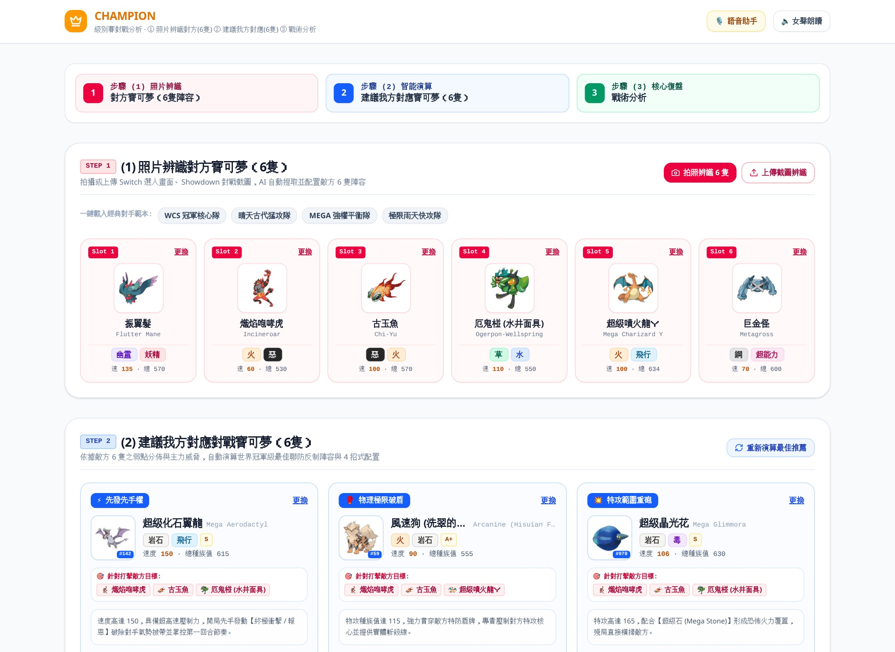

# Champion 級別賽對戰分析 (Competitive Battle Analyzer)

[](https://ais-dev-jvak75xkk52uysj6wttnap-56578231960.us-west1.run.app)
[](https://react.dev/)
[](https://www.typescriptlang.org/)
[](https://tailwindcss.com/)

> **Champion 級別賽對戰分析** 是一款專為寶可夢排位賽與冠軍錦標賽打造的專業單頁戰術決策平台。整合 Gemini AI 視覺照片識別、即時隊伍弱點對位演算、勝率預測矩陣與女聲語音戰術朗讀。

---

## 🌐 線上體驗連結 (App URL)

- **網頁連結 (App Link)**:  
  👉 **[https://ais-dev-jvak75xkk52uysj6wttnap-56578231960.us-west1.run.app](https://ais-dev-jvak75xkk52uysj6wttnap-56578231960.us-west1.run.app)**

---

## 📸 應用實際截圖 (App Real Screenshot)



---

## ✨ 核心對戰流程與功能

### 1. 📷 照片辨識對方寶可夢（6隻）
- 支援對戰選人畫面照片上傳或截圖貼上。
- 多模態 Gemini AI 視覺模型精準辨識對手 6 隻寶可夢（含超級進化與阿羅拉/洗翠/帕底亞地區型態）。
- 亦支援點擊手動選角、即時中英文名稱搜尋與屬性快選。

### 2. 🛡️ 建議我方對應對戰寶可夢（6隻）
- **一鍵自動生成最優解**：基於 18 屬性相剋矩陣、打點覆蓋、速線壓制與功能性（特攻/物攻/控速/聯防）自動推薦我方對應 6 隻陣容。
- 顯示每隻寶可夢的最佳 4 招式配置、推薦攜帶道具、太晶屬性、特性、努力值分配與戰術定位。

### 3. 📊 戰術分析與勝率預測
- **動態勝率計算**：深度模擬我方與對方 6v6 對位優劣與整體攻防權重。
- **速度線對決 (Speed Tier)**：實時展示雙方實數速度分級，精確掌握先攻與後攻次序。
- **18 屬性剋制矩陣**：視覺化熱力圖標示強勢打點與弱點防禦。
- **4 步開局與轉場錦囊**：首發建議、換防時機、聯防阻截與殘局收割策略。

### 4. 🔊 女聲語音戰術朗讀
- 內建高清晰度女性語音合成（Web Speech API），在緊湊的對戰倒數計時中，無需分心閱讀文字，隨時聆聽即時戰術指引。

### 5. 📖 擴充圖鑑資料庫 (186+ 至 352+ 隻)
- 收錄超級進化 (Mega Evolution)、洗翠/阿羅拉/伽勒爾/帕底亞型態。
- 具備完整 6 維種族值、最佳特性、主流賽事配招與攜帶物。

---

## 🛠️ 技術架構

- **Frontend**: React 18, TypeScript, Tailwind CSS, Lucide Icons
- **AI Recognition**: Server-side Google Gemini Vision API (`/api/recognize-team`)
- **Speech**: HTML5 Web Speech Synthesis API (女聲優選引擎)
- **Tooling & Build**: Vite, Express, Node.js

---

## 🚀 本地開發與啟動 (Local Setup)

```bash
# 1. 安裝相依套件
npm install

# 2. 設定環境變數 (如需自訂 API Key)
cp .env.example .env

# 3. 啟動本機開發伺服器 (Port 3000)
npm run dev
```

開啟瀏覽器前往 `http://localhost:3000` 即可進行本地測試。

---

## ⚠️ 免責聲明 (Disclaimer)

本網站為粉絲自製，與 Nintendo、Game Freak、The Pokémon Company 無關。
All Pokémon assets and names are properties of Nintendo, Creatures Inc., and GAME FREAK Inc.
